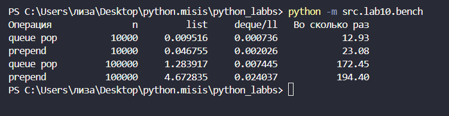
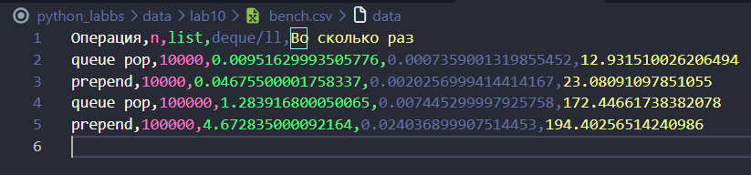

# ЛР10 — Структуры данных: `Stack, Queue, Linked List и бенчмарки`

## Содержание
[***`Теория(СТЕК/ОЧЕРЕДЬ/ОДНОСВЯЗНЫЙ СПИСОК)`***](#теория)

**1)** [**Задание А - `src/lab10/structures.py`**](#задание-а---srclab10structurespy)
+ [`Разбор кода`](#разбор-кода)
  + [***a) Функции для стека***](#a-функции-для-стека)
  + [***б) Функции для очереди***](#б-функции-для-очереди)
  + [***в) Задача на стек***](#в-задача-на-стек)

**2)** [***Задание В - `src/lab10/linked_list.py`***](#задание-в---srclab10linked_listpy)
+ [`Разбор кода`](#разбор-кода-1)

**3)** [***Задание С - `src/lab10/bench.py`***](#задание-с---srclab10benchpy)
+ [`Запуск кода`](#запуск-кода)

[***Выводы по бенчмаркам***](#выводы-по-бенчмаркам)
## `Теория`

### ***СТЕК*** - (*«последним пришёл, первым вышел»*)
- **Операции:** 
  - `push` — положить наверх;
  - `pop` — снять верхний;
  - `peek` — посмотреть верхний, не снимая.
- **Сложность:** Все операции выполняются за **O(1)**, потому что мы работаем только с концом массива

### ***ОЧЕРЕДЬ*** - (*«первым пришёл, первым вышел»*)
- **Операции:**
  - `enqueue` — добавить в конец;
  - `dequeue` — забрать из начала;
  - `peek` — посмотреть первого, не забирая.
- **Сложность:** 
  - Удаление из начала обычного `list` (`pop(0)`) занимает `O(n)`, так как все оставшиеся элементы сдвигаются влево.
  - `collections.deque` делает это за `O(1)`, так как элементы не сдвигаются, а просто отцепляются.


### ***Односвязный список***
- **Принцип:** Это цепочка из узлов `Node`. Каждый узел хранит значение `value` и ссылку на следующий `next`
- **Сложность:**
  - `prepend` (вставка в начало) — **`O(1)`**
  - `append` (вставка в конец) — **`O(n)`**
  - Поиск по индексу — **`O(n)`**


## Задание А - `src/lab10/structures.py`
### `Разбор кода`
#### ***a) Функции для стека***

`stack_push(st, item)`
```
def stack_push(st, item):
    st.append(item)
```
> *Добавляет элемент на вершину стека.*
---
`stack_pop(st)`
```
def stack_pop(st):
    if not st:
        raise IndexError("Стек пуст!")
    
    return st.pop()
```
> *Проверяет пуст ли стек или нет, если нет, то снимает верхний элемент стека и его возвращает.*
---
`stack_peek(st)`
```
def stack_peek(st):
    if not st:
        return None
    
    return st[-1]
```
> *Также проверяет пустой стек или нет. Возвращает верхний элемент без его снятия.*
---
`stack_is_empty(st)`
```
def stack_is_empty(st):
    return len(st)==0
```
> *Возвращает `True` если стек пустой и `False` если нет.*
---
---
---
#### ***б) Функции для очереди***

`queue_enqueue(q, item)`
```
def queue_enqueue(q, item):
    q.append(item)
```
> *Добавление элемента в конец очереди.*
---
`queue_dequeue(q)`
```
def queue_dequeue(q):
    if not q:
        raise IndexError("Очередь пустая!")

    return q.popleft()
```
> *Берет элемент из начала очереди и возвращает его.*
> + `q.popleft()` *- снимает и возвращает элемент очереди с начала*
> + *функция возвращает `IndexError`, если очередь пустая*
---
`queue_peek(q)`
```
def queue_peek(q):
    if not q:
        return None

    return q[0]
```
> *Возвращает первый элемент очереди **без удаления**.*
---
`queue_is_empty(q)`
```
def queue_is_empty(q):
    return len(q)==0
```
> *Такая же функция как и в стеке, на проверку **пустоты очереди***
---
---
---
#### ***в) Задача на стек***

`is_balanced(s)`
```
def is_balanced(s):
    stack = []
    pairs = { ')':'(', ']':'[', '}':'{' }

    for ck in s:
        if ck in '([{':
            stack.append(ck)

        elif ck in ')]}':
            if not stack or stack.pop() != pairs[ck]:
                return False

    return len(stack) == 0
```
> *Функция осуществляет проверку правильности скобочной последовательности.*
> + `stack` - *заносим туда **скобки**, которые уже видели и потом сравниваем, чтобы убедиться, что скобка была закрыта*
---
---
---
---
## Задание В - `src/lab10/linked_list.py`
### `Разбор кода`
`class Node`
```
class Node:

    def __init__(self, value, next=None):
        self.value = value
        self.next = next
```
> *Создание узла односвязного списка (запись из двух полей: `value` и `next`)*
---
`ll_from_list(values)`
```
def ll_from_list(values):
    head = None

    for i in reversed(values):
        head = Node(i, head)

    return head
```
> *Функция создает односвязный список(делает это справа налево, так как без `reversed` через `Node` добавление происходит в начало и тогда переворачивает сам список).*
---
`ll_to_list(head)`
```
def ll_to_list(head):
    res = []

    cur = head
    while cur is not None:
        res.append(cur.value)
        cur = cur.next
    return res
```
> *Функция по каждому элементу преобразуе копию односвязного списка в обычный список.*
---
`ll_length(head)`
```
def ll_length(head):
    n = 0
    cur = head

    while cur is not None:
        n += 1
        cur = cur.next

    return n

```
> *Функция считает количество узлов в односвязном списке.*
---
`ll_prepend(head, value)`
```
def ll_prepend(head, value):
    return Node(value, head)
```
> Функция добавляет элемент в начало связного списка, сохраняя прежний в `head`.
> + то есть `Node(value, head)` берет новое значение как за первый элемент и в качестве связки берет `head`, где весь старый связный список
---
`ll_append(head, value)`
```
def ll_append(head, value):
    new_node = Node(value)

    if head is None:
        return new_node
    cur = head

    while cur.next is not None:
        cur = cur.next

    cur.next = new_node
    return head
```
> *Функция проходит до последнего элемента связного списка, не являющегося `None`. После берет значение `cur.next`, зная что оно является `None` и передает туда связку из `новый элемент - > None`*
---
`ll_insert(head, idx, value)`
```
def ll_insert(head, idx, value):

    if idx < 0:
        raise IndexError("idx < 0")
    if idx == 0:
        return Node(value, head)

    cur = head
    for i in range(idx - 1):
        if cur is None:
            raise IndexError("Недопустимый индекс!")
        cur = cur.next

    if cur is None:
        raise IndexError("Недопустимый индекс!")

    cur.next = Node(value, cur.next)
    return head
```
> *Функция добавляет элемент по индексу в связной список*
> + `idx==0` - > возвращает тот же список
> + `idx==конец списка` - > добавляет в конец
---
`ll_remove(head, value)`
```
def ll_remove(head, value):

    if head is None:
        raise ValueError("Список пуст!")
    
    if head.value == value:
        return head.next

    cur = head
    while cur.next is not None:
        if cur.next.value == value:
            cur.next = cur.next.next
            return head

        cur = cur.next

    raise ValueError(f"Значение {value} не найдено")
```
> *Функция удаляет первое вхождение значения `value`(если значения нет, то кидает `ValueError`)*
---
`ll_reverse(head)`
```
def ll_reverse(head):

    prev = None
    cur = head
    while cur is not None:
        nxt = cur.next
        cur.next = prev
        prev = cur
        cur = nxt
    return prev
```
> *Переворачивает список задом наперед.*
---
`ll_repr(head)`
```
def ll_repr(head):

    parts = []
    cur = head
    while cur is not None:
        parts.append(f'[{cur.value}]')
        cur = cur.next

    return " -> ".join(parts) + " -> None" if parts else "None"
```
> *Функция возвращает строковое представление (если список пуст, то возвращает `None`)*
---
---
---
---
## Задание С - `src/lab10/bench.py`
```
import timeit
from collections import deque

import csv
from pathlib import Path

from src.lab10.linked_list import ll_prepend


def bench_queue(n):
    l = list(range(n))
    dq = deque(range(n))
    t_list = timeit.timeit(lambda: l.pop(0), number=n)
    t_deque = timeit.timeit(lambda: dq.popleft(), number=n)
    return t_list, t_deque


def bench_prepend(n):
    l = []
    t_list = timeit.timeit(lambda: l.insert(0, 0), number=n)

    head = None

    def prepend_n():
        nonlocal head
        for i in range(n):
            head = ll_prepend(head, i)

    t_ll = timeit.timeit(prepend_n, number=1)
    return t_list, t_ll

def write_csv(path, headers, rows):
    path = Path(path)
    path.parent.mkdir(parents=True, exist_ok=True)
    with path.open('w', newline='', encoding='utf-8') as f:
        writer = csv.writer(f)
        writer.writerow(headers)
        writer.writerows(rows)

def main():

    ns = [10_000, 100_000]
    rows = []
    headers = ['Операция', 'n', 'list', 'deque/ll', 'Во сколько раз']

    for n in ns:
        t_list_q, t_deque_q = bench_queue(n)
        ratio_q = t_list_q / t_deque_q if t_deque_q else float('inf')
        rows.append(('queue pop', n, t_list_q, t_deque_q, ratio_q))

        t_list_p, t_ll_p = bench_prepend(n)
        ratio_p = t_list_p / t_ll_p if t_ll_p else float('inf')
        rows.append(('prepend', n, t_list_p, t_ll_p, ratio_p))

    print(f"{'Операция':<15} {'n':>8} {'list':>12} {'deque/ll':>12} {'Во сколько раз':>16}")
    for op, n, t_list, t_other, ratio in rows:
        print(f"{op:<15} {n:>8} {t_list:>12.6f} {t_other:>12.6f} {ratio:>16.2f}")

    write_csv('data/lab10/bench.csv', headers, rows)


if __name__ == '__main__':
    main()
```
### `Запуск кода`
**ВВОД:**
```
python -m src.lab10.bench
```
**ВЫВОД:** -> `bench.csv`




---
### ***Выводы по бенчмаркам***

**1) Почему `pop(0)` медленный?** Удаление из начала обычного `list (pop(0))` требует сдвига всех элементов `O(n)`, поэтому для очередей используют `deque`, которая забирает элементы за `O(1)` без сдвигов.

**2) Почему `ll_prepend` не медленнее с ростом n?** По той же причине `ll_prepend` в 153 раза быстрее `list.insert(0, x)` на 100 000 элементах. Он просто меняет одну ссылку за `O(1)`, а не сдвигает весь массив.
