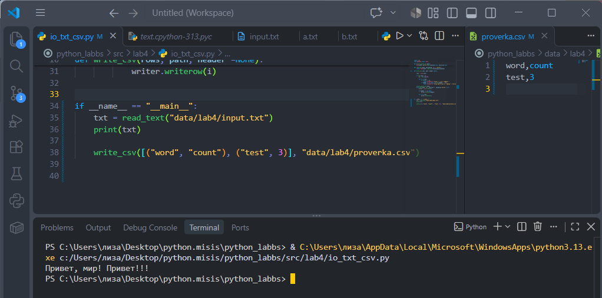
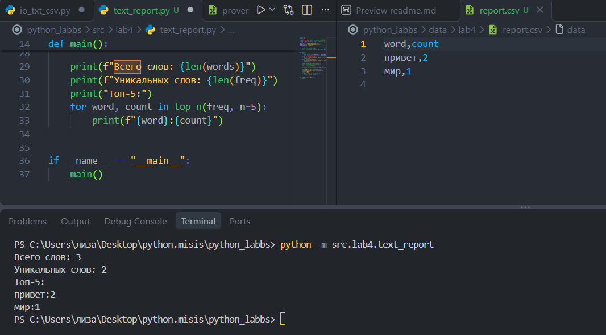
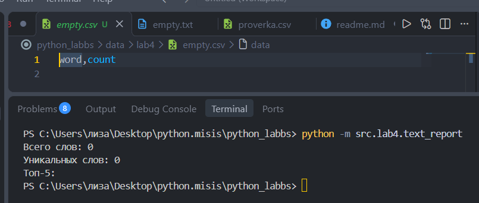

# ЛР4 — Файлы: TXT/CSV и отчёты по текстовой статистике

## Задание A — модуль `src/lab04/io_txt_csv.py`
## **`Тест`**



### **`Код`**
```
import csv
from pathlib import Path

def ensure_parent_dir(path: str | Path) -> None:
    Path(path).parent.mkdir(parents=True, exist_ok=True)

def read_text(path, encounding: str = "utf-8") -> str:
    return Path(path).read_text(encoding=encounding)

def write_csv(rows: list[tuple | list], path: str | Path, header: tuple[str, ...] | None = None) -> None:

    rows = list(rows)

    if len(rows) > 0:
        dl = len(rows[0])

        for i in rows:
            if len(i) != dl:
                raise ValueError('длина строк не совпадает')
        if header is not None and len(header) != dl:
            raise ValueError('длина заголовка не совпадает с длиной строк')

    ensure_parent_dir(path)
    with open(path, 'w', newline="", encoding="utf-8") as f:
        writer = csv.writer(f)

        if header is not None:
            writer.writerow(header)

        for i in rows:
            writer.writerow(i)


if __name__ == "__main__":
    txt = read_text("data/lab4/input.txt")
    print(txt)

    write_csv([("word", "count"), ("test", 3)], "data/lab4/proverka.csv")
```
### **`Разбор кода`**

```
def ensure_parent_dir(path):
    Path(path).parent.mkdir(parents=True, exist_ok=True)
```
> Фукнция создает все недостающие родительские папки

>  `".mkdir"` -> то есть "make directory"(создание папки)
>  - `parents=True` - нужна если родительской папки нет, то создает ее
> - `exist_ok=True` -> если папка не существует не вызывать ошибку

---
```
def read_text(path, encounding: str = "utf-8"):
    return Path(path).read_text(encoding=encounding)
```
> `.read_text()` - отвечает за открытие и чтение всего файла(автоматически закрывает файл)

> **Другая кодировка выбирается параметром encoding, например:
    `read_text("data/lab4/input.txt", encoding="cp1251")`**
----
## **Функция - `write_csv`**

```
def write_csv(rows, path, header =None):

    rows = list(rows)

    if len(rows) > 0:
        dl = len(rows[0])

        for i in rows:
            if len(i) != dl:
                raise ValueError('длина строк не совпадает')
        if header is not None and len(header) != dl:
            raise ValueError('длина заголовка не совпадает длиной строк')

    ensure_parent_dir(path)
    with open(path, 'w', newline="", encoding="utf-8") as f:
        writer = csv.writer(f)

        if header is not None:
            writer.writerow(header)

        for i in rows:
            writer.writerow(i)

```
> Проходимся по списку и проверяем, чтобы длина строк и заголовка была одинакова
> `open(path, 'w', newline="", encoding="utf-8")` - открытие файла
> + `path`  - сам файл
> + `"w"`  - то есть "write" = перенаписание файла
> + `newline=""`  - необходимо, чтобы питон не редактировал файл, так как расширение csv - уже это сделало
> + `encoding="utf-8"`  - кодировка, в которой будет записан текст

> `writer = csv.writer(f)` - создание "писателя" для CSV

> `writer.writerow()` - записывает строку
-------
```
if __name__ == "__main__":
    txt = read_text("data/lab4/input.txt")
    print(txt)

    write_csv([("word", "count"), ("test", 3)], "data/lab4/proverka.csv")
```
> Читает и выводит текст из `input.txt`, а затем записывает две строки данных в файл `proverka.csv`

----
---
## Задание B — скрипт `src/lab4/text_report.py`

### **Тест**



### **Как осуществляется запуск `text_report.py`?**

> Запуск производится из корня репозитория(поэтому запускаем не как файл, а как модуль = `-m`):
```
python -m src.lab4.text_report
```


### **Код**

```
import sys

from src.lib.text import normalize, tokenize, count_freq, top_n
from src.lab4.io_txt_csv import read_text, write_csv

INPUT_FILE = "data/lab4/input.txt"
REPORT_FILE = "data/lab4/report.csv"
FILE_ENCODING = "utf-8"  

def sorted_word_counts(freq):
    return sorted(freq.items(), key=lambda pair: (-pair[1], pair[0]))


def main():
    try:
        text = read_text(INPUT_FILE, encounding=FILE_ENCODING)
    except FileNotFoundError:
        print(f"Ошибка: файл не найден: {INPUT_FILE}")
        sys.exit(1)
    except UnicodeDecodeError:
        print(f"Ошибка: файл не читается в кодировке {FILE_ENCODING}")
        sys.exit(1)

    words = tokenize(normalize(text))
    freq = count_freq(words)

    write_csv(sorted_word_counts(freq), REPORT_FILE, header=("word", "count"))

    print(f"Всего слов: {len(words)}")
    print(f"Уникальных слов: {len(freq)}")
    print("Топ-5:")
    for word, count in top_n(freq, n=5):
        print(f"{word}:{count}")


if __name__ == "__main__":
    main()
```
### **Разбор кода**
- `INPUT_FILE` - путь файла для чтения
- `REPORT_FILE` - путь файла куда запишем CSV
- `FILE_ENCODING` - указание нужной нам кодировки

```
def main():
    try:
        text = read_text(INPUT_FILE, encounding=FILE_ENCODING)
    except FileNotFoundError:
        print(f"Ошибка: файл не найден: {INPUT_FILE}")
        sys.exit(1)
    except UnicodeDecodeError:
        print(f"Ошибка: файл не читается в кодировке {FILE_ENCODING}")
        sys.exit(1)
```
> Функция пробует прочитать файл, если возникает ошибка, функция **красиво** возвращает тип ошибки

### **`Обработка краевых ситуаций и ошибок`**
- **Пустой файл** -> `empty.csv` пишет только **word,count**, а терминал выводит нули



- **Кодировка** -> другая кодировка выбирается параметром encoding, например: `read_text("data/lab4/input.txt", encoding="cp1251")`**

- **Файл не найден**
