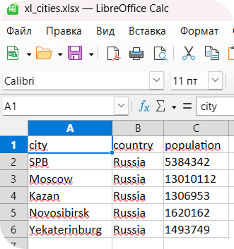

# ЛР5 — JSON и конвертации `(JSON↔CSV, CSV→XLSX)`
### `Содержание`
 **1)** [**Задание A — JSON ↔ CSV**](#Задание_A_—_JSON_↔_CSV)
+ [*json_csv.py*](#Код`(json_csv.py)`)
+ [Разбор кода:](#разбор-кода)
  + [*def proverka...*](#функцияproverka)
  + [*def json_to_csv...*](#функцияjson_to_csv---конвертирует-из-json-в-сsv)
  + [*def csv_to_json...*](#функцияcsv_to_json---конвертирует-из-csv-в-json)
+ [***ТЕСТЫ ДЛЯ ЗАДАНИЯ А***](#тесты-для-задания-а)

**2)** [**Задание В - CSV ↔ XLSX**](#задание-в---csv--xlsx)
+ [*csv_xlsx.py*](#csv_xlsxpy)
+ [Разбор всего кода](#разбор-кода-1)
+ [***ТЕСТ ДЛЯ ЗАДАНИЯ В***](#тест-для-задания-в)


## Задание A — `JSON ↔ CSV`

### Код`(json_csv.py)`

```
import csv
import json
from pathlib import Path

JSON_PATH = "data/samples/people.json"
CSV_PATH = "data/samples/people.csv"

CSV_TO = 'data/out/people_from_csv_to_json.json'
JSON_TO = 'data/out/people_from_json_to_csv.csv'

def proverka(path, EXT):
    p = Path(path)

    if p.suffix.lower() != EXT:
        raise ValueError(f"Неверный тип файла")
    if not p.exists():
        raise FileNotFoundError(f"Файл {path} не существует")
    return p

def json_to_csv(json_path, csv_path):

    with proverka(json_path, ".json").open(encoding='utf-8') as f:
        data = json.load(f)

    if not isinstance(data, list) or not data or not all(isinstance(r, dict) for r in data):
        raise ValueError('Нет данных или неподдерживаемый тип данных')
    fields = list(dict.fromkeys(i for r in data for i in r))
    Path(csv_path).parent.mkdir(parents=True, exist_ok=True)

    with open(csv_path, "w", newline="", encoding='utf-8') as f:
        w = csv.DictWriter(f, fieldnames=fields, restval="")
        w.writeheader()
        w.writerows(data)

def csv_to_json(csv_path, json_path):

    with proverka(csv_path, '.csv').open(newline="", encoding='utf-8') as f:
        read = csv.DictReader(f)
        if not read.fieldnames:
            raise ValueError('CSV без заголовка')
        rows = list(read)

    if not rows:
        raise ValueError('CSV пустой')

    Path(json_path).parent.mkdir(parents=True, exist_ok=True)

    with open(json_path, "w", encoding='utf-8') as f:
        json.dump(rows, f, ensure_ascii=False, indent = 2)

if __name__ == "__main__":
    json_to_csv(JSON_PATH, JSON_TO)
    csv_to_json(CSV_PATH, CSV_TO)

```
## **`Разбор кода`**
### Функция`(proverka)`
```
def proverka(path, EXT):
    p = Path(path)

    if p.suffix.lower() != EXT:
        raise ValueError(f"Неверный тип файла")
    if not p.exists():
        raise FileNotFoundError(f"Файл {path} не существует")
    return p
```
> Функция `proverka` проверяет, что файл существует и имеет нужное расширение. При отсутствии ошибок возвращает просто путь как объект.
- `p.suffix.lower()` -> возвращает расширение файла и переводит его в нижний регистр для сравнения
- `p.exists()` -> проверяет существует файл или нет(возвращает `True` или `False`)
----
---
### Функция`(json_to_csv)` -> конвертирует из JSON в СSV
```
def json_to_csv(json_path, csv_path):

    with proverka(json_path, ".json").open(encoding='utf-8') as f:
        data = json.load(f)

    if not isinstance(data, list) or not data or not all(isinstance(r, dict) for r in data):
        raise ValueError('Нет данных или неподдерживаемый тип данных')
    fields = list(dict.fromkeys(i for r in data for i in r))
    Path(csv_path).parent.mkdir(parents=True, exist_ok=True)

    with open(csv_path, "w", newline="", encoding='utf-8') as f:
        w = csv.DictWriter(f, fieldnames=fields, restval="")
        w.writeheader()
        w.writerows(data)
```
---
---
---
```
with proverka(json_path, ".json").open(encoding='utf-8') as f:
        data = json.load(f)
```
> Файл открывается с кодировкой `"UTF-8"`

 >+ `data = json.load(f)` - > функция считывает как JSON объект и преобразовывает в структуру данных Python, после файл заносится в  `data` 

---
```
if not isinstance(data, list) or not data or not all(isinstance(r, dict) for r in data):
        raise ValueError('Нет данных или неподдерживаемый тип данных')
```
> Проверка, что данные являются списком словарей или вовсе отсутствуют
>+ `isinstance(data, list)` - > входные данные это список
>+ `all(isinstance(r, dict) for r in data)` - > каждый элемент списка это словарь

----
---
> **`fields = list(dict.fromkeys(i for r in data for i in r))`**
> - Собирает список всех уникальных ключей из списка словарей `data`, сохраняя порядок первого появления.
---
---
```
with open(csv_path, "w", newline="", encoding='utf-8') as f:
        w = csv.DictWriter(f, fieldnames=fields, restval="")
        w.writeheader()
        w.writerows(data)
```
> **`w = csv.DictWriter(f, fieldnames=fields, restval="")`**(создается объект писатель, способный записывать словари в CSV)
> + `fieldnames=fields` - > список колонок
> + `restval=""` - > если значения для ключа нет, то запишется просто пустая строка

> `w.writeheader()` - записывает в первую строку колонки, то есть наш заголовок
> `w.writerows(data)` - записывает по одной строке CSV на каждый словарь
---
---
---
## Функция`(csv_to_json)` -> конвертирует из CSV в JSON
```
def csv_to_json(csv_path, json_path):

    with proverka(csv_path, '.csv').open(newline="", encoding='utf-8') as f:
        read = csv.DictReader(f)
        if not read.fieldnames:
            raise ValueError('CSV без заголовка')
        rows = list(read)

    if not rows:
        raise ValueError('CSV пустой')

    Path(json_path).parent.mkdir(parents=True, exist_ok=True)

    with open(json_path, "w", encoding='utf-8') as f:
        json.dump(rows, f, ensure_ascii=False, indent = 2)
```
---
### `Разбор функции`
```
with proverka(csv_path, '.csv').open(newline="", encoding='utf-8') as f:
        read = csv.DictReader(f)
        if not read.fieldnames:
            raise ValueError('CSV без заголовка')
        rows = list(read)
```
> + `read = csv.DictReader(f)` - читатель, который возвращает *словари*

> Функция открывает файл, записывает в `read` CSV как словарь, также фукнция проверяет наличие заголовка в CSV
> + `rows = list(read)` - складываем все словари в единый список

```
with open(json_path, "w", encoding='utf-8') as f:
    json.dump(rows, f, ensure_ascii=False, indent = 2)
```
> `json.dump` - записывает `rows` в JSON файл
> + `rows` - что записывается
> + `f` - куда записывается
> + `ensure_ascii=False` - необходимо, чтобы в JSON файл кириллица и другие не-ASCII символы записывались как есть, а не непонятной последовательностью
> + `indent = 2` - даёт отступ в 2 пробела для красивой записи
---
----
---
## **`ТЕСТЫ ДЛЯ ЗАДАНИЯ А`**
### `JSON_CSV`
**ВХОДНЫЕ ДАННЫЕ - > `people.json`**
```
[{"name": "Alice", "age": 22},{"name": "Bob", "age": 25}]
```
**ВЫВОД - > `people_from_json_to_csv.csv`**
```
name,age
Alice,22
Bob,25
```
---
---
### `CSV_TO_JSON`
**ВХОДНЫЕ ДАННЫЕ - > `people.csv`**
```
name,age,city
Alice,22,SPB
Bob,25,Moscow
```
**ВЫВОД - > `people_from_csv_to_json.json`**
```
[
  {
    "name": "Alice",
    "age": "22",
    "city": "SPB"
  },
  {
    "name": "Bob",
    "age": "25",
    "city": "Moscow"
  }
]
```

## Задание В - `CSV ↔ XLSX`
### `csv_xlsx.py`
```
import csv
from pathlib import Path

from openpyxl import Workbook
from openpyxl.utils import get_column_letter

from json_csv import proverka

CSV_PATH = 'data/samples/cities.csv'
CSV_TO_XL = 'data/out/xl_cities.xlsx'

def csv_xlsx(csv_path, xlsx_path):

    with proverka(csv_path, '.csv').open(newline="", encoding='utf-8') as f:
        rows = list(csv.reader(f))

    if not rows:
        raise ValueError('Пустой CSV')
    wb = Workbook()
    ws = wb.active
    ws.title = "Sheet1"
    for r in rows:
        ws.append(r)
    for i in range(len(rows[0])):
        width = max(8, *[len(r[i]) for r in rows if i < len(r)])
        ws.column_dimensions[get_column_letter(i+1)].width = width

    Path(xlsx_path).parent.mkdir(parents=True, exist_ok=True)
    wb.save(xlsx_path)

if __name__ == "__main__":
    csv_xlsx(CSV_PATH, CSV_TO_XL)
```
## `Разбор кода`
> + `rows = list(csv.reader(f))` - читает CSV  и преобразует в список строк

> + `wb = Workbook()` - создание нового пустого EXEL файла
> + `ws = wb.active` - берем **активную** страницу документа, в нашем случае первую так как документ только создан
---
```
for r in rows:
        ws.append(r)
```
> Построчно добавляет все строки из `rows` в документ
```
for i in range(len(rows[0])):
        width = max(8, *[len(r[i]) for r in rows if i < len(r)])
        ws.column_dimensions[get_column_letter(i+1)].width = width
```
> Цикл по колонкам, берем наибольшую ширину, где наименьшая возможная это **8**

> ` width = max(8, *[len(r[i]) for r in rows if i < len(r)])`
> + Собирает длины значений в колонке `i` по всем строкам и с помощью `*` распаковывает
> + `i < len(r)` - защита от *`рваных строк`*
---

---
```
ws.column_dimensions[get_column_letter(i+1)].width = width
```
> + `ws.column_dimensions.width` - доступ к изменения свойств колонок(ширины, стиля и тд), `.width` - то есть в нашем случае это задание *ширины*
> + `i + 1`  - перевод в нумерацию `EXCEL`
> + `get_column_letter()` - превращает числовое значение в буквенное имя в `EXCEL`

> `wb.save(xlsx_path)` - сохраняет документ `EXCEL` по выбранному пути
---
---
---
## `ТЕСТ ДЛЯ ЗАДАНИЯ В`
**ВХОДНЫЕ ДАННЫЕ - > `cities.csv`**
```
city,country,population
SPB,Russia,5384342
Moscow,Russia,13010112
Kazan,Russia,1306953
Novosibirsk,Russia,1620162
Yekaterinburg,Russia,1493749
```
**ВЫВОД - > `xl_cities.xlsx`**

