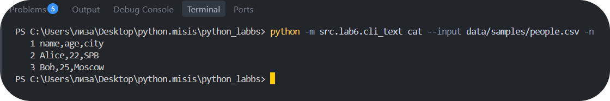
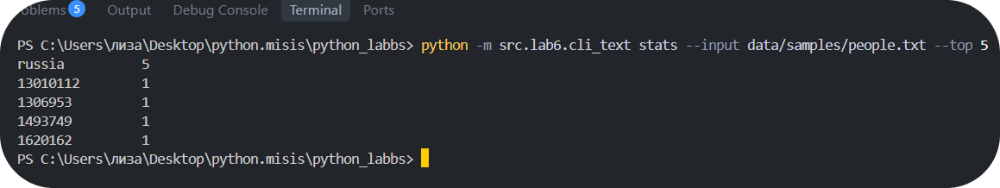
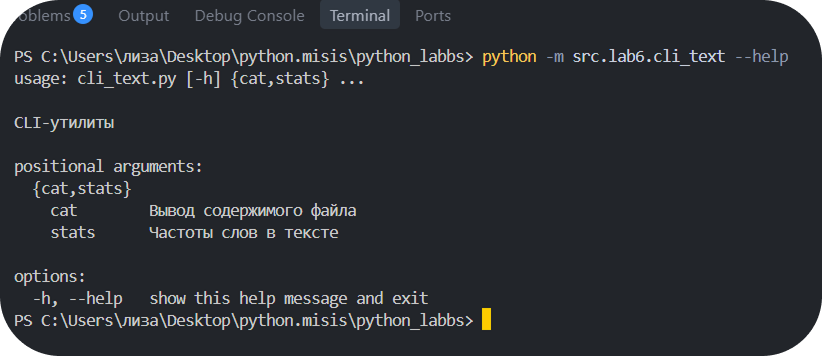
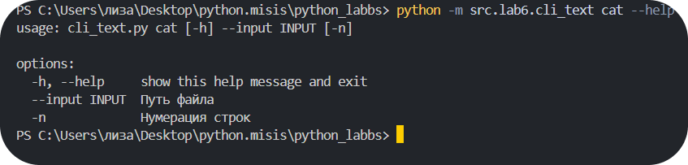
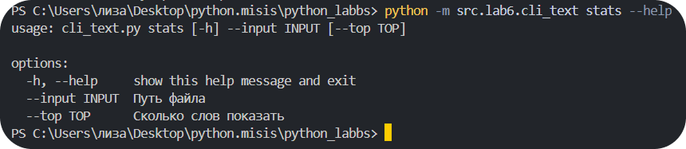
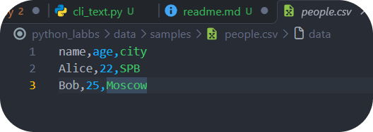
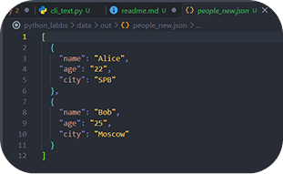
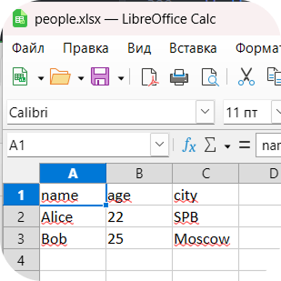
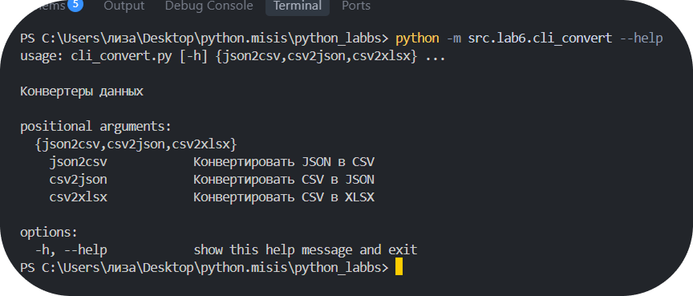
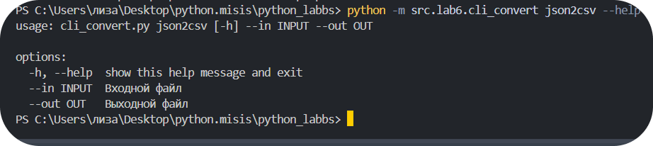

# ЛР6 — `CLI‑утилиты с argparse (cat/grep‑lite + конвертеры)`

### `Содержание`

**1)** [**МОДУЛЬ** `src/lab6/cli_text.py`](#модуль-srclab6cli_textpy----cmd_cat-cmd_stats)
  + [*Код*](#код)
    + [`Разбор кода:`](#разбор-кода)
      + [***cmd_cat()***](#cmd_cat)
      + [***cmd_stats()***](#cmd_stats)
      + [***builder_parser()***](#builder_parser)
      + [***main()***](#main)
  + [***ТЕСТЫ***](#тесты)
  + [***ПРОВЕРКИ "--help"***](#проверки---help)

**2)** [**МОДУЛЬ** `src/lab06/cli_convert.py`](#модуль-srclab06cli_convertpy)
+ [*Код*](#код-1)
+ [`Разбор кода`](#разбор-кода-1)
+ [***ТЕСТЫ***](#тесты-1)
+ [***ПРОВЕРКИ "--help"***](#проверки---help-1)
## Модуль `src/lab6/cli_text.py` - > `cmd_cat`, `cmd_stats`

### `Код`
```
import argparse
import sys
from pathlib import Path

from src.lib.text import normalize, tokenize, count_freq, top_n

def proverka(path):
    p = Path(path)

    if not p.is_file():
        raise FileNotFoundError(f"Файл {p} не найден")
    return p

def cmd_cat(input_file, n):
    p = proverka(input_file)

    with p.open("r", encoding='utf-8') as f:
        for i, line in enumerate(f, start = 1):
            line = line.rstrip("\n")
            print(f"{i:>4} {line}" if n else line)

def cmd_states(input_file, n):
    p = proverka(input_file)
    text = p.read_text(encoding='utf-8')

    token = tokenize(normalize(text))
    freq = count_freq(token)

    for word, count in top_n(freq, n):
        print(f"{word:<15} {count}")

def builder_parser():
    parser = argparse.ArgumentParser(description="CLI-утилиты")
    sub = parser.add_subparsers(dest="command", required=True)

    p_cat = sub.add_parser("cat", help= "Вывод содержимого файла")
    p_cat.add_argument("--input", required=True, help="Путь файла")
    p_cat.add_argument("-n", action="store_true", help="Нумерация строк")

    p_stats = sub.add_parser("stats", help = "Частоты слов в тексте")
    p_stats.add_argument("--input", required=True, help="Путь файла")
    p_stats.add_argument("--top", type=int, default=5, help="Сколько слов показать")

    return parser

def main():
    parser = builder_parser()
    args = parser.parse_args()

    if args.command == "stats" and args.top <= 0:
        parser.error("--top не является положительным числом")

    try:
        if args.command == "cat":
            cmd_cat(args.input, args.n)
        elif args.command == "stats":
            cmd_states(args.input, args.top)

    except FileNotFoundError:
        print(f"Ошибка: файл {args.input} не найден")
        sys.exit(1)

    except UnicodeDecodeError:
        print(f"Ошибка: неверная кодировка")
        sys.exit(1)

if __name__ == "__main__":
    main()
```
### `Разбор кода:`

### `cmd_cat()`
```
def cmd_cat(input_file, n):
    p = proverka(input_file)

    with p.open("r", encoding='utf-8') as f:
        for i, line in enumerate(f, start = 1):
            line = line.rstrip("\n")
            print(f"{i:>4} {line}" if n else line)
```
> `for i, line in enumerate(f, start = 1):` - идёт по файлу построчно
> + `start = 1` - нумерация, начиная с единицы
---
> + `.rstrip("\n")` - убираем символ перевода строки 
> + `{i:>4}` - выравнивание по правому краю, минимальная ширина символов = `4`

### `cmd_stats()`
```
def cmd_states(input_file, n):
    p = proverka(input_file)
    text = p.read_text(encoding='utf-8')

    token = tokenize(normalize(text))
    freq = count_freq(token)

    for word, count in top_n(freq, n):
        print(f"{word:<15} {count}")
```
> `text = p.read_text(encoding='utf-8')` - читает содержимое файла в одну строку с кодировкой `utf-8`
> `{word:<15}` - выводит слово с выравниванием по левому краю, с минимальной длиной символов = `15`

### `builder_parser()`
```
def builder_parser():
    parser = argparse.ArgumentParser(description="CLI-утилиты")
    sub = parser.add_subparsers(dest="command", required=True)

    p_cat = sub.add_parser("cat", help= "Вывод содержимого файла")
    p_cat.add_argument("--input", required=True, help="Путь файла")
    p_cat.add_argument("-n", action="store_true", help="Нумерация строк")

    p_stats = sub.add_parser("stats", help = "Частоты слов в тексте")
    p_stats.add_argument("--input", required=True, help="Путь файла")
    p_stats.add_argument("--top", type=int, default=5, help="Сколько слов показать")
```
>- `parser = argparse.ArgumentParser` - создание главного парсера/бланка для "заполнения"

> `sub = parser.add_subparsers(dest="command", required=True)` - делает парсер многоуровневым для добавления аргументов для `cat` и `stats`
> + `dest="command"` - после введения команды она сохранится в `args.command`
>+ `required=True` - показывает, что введение команды обязательно

>`p_cat = sub.add_parser("cat", help= "Вывод содержимого файла")` - создание ***"уровня"*** в парсере
> + `ПЕРВЫЙ АРГУМЕНТ/"cat"/"stats"` - название ***команды***
>+ `help = ""` - вспомогательная строка при вводе `"--help"`

>`p_cat.add_argument("-n", action="store_true", help="Нумерация строк")` - добавление аргумента
> + `action="store_true"` - по умолчанию стоит ***`"store"`***, то есть просто заносить данные, но ***`"store_true"`*** означает, что присваивается флаг `True` или `False`(галочка)

### `main()`
```
def main():
    parser = builder_parser()
    args = parser.parse_args()

    if args.command == "stats" and args.top <= 0:
        parser.error("--top не является положительным числом")

    try:
        if args.command == "cat":
            cmd_cat(args.input, args.n)
        elif args.command == "stats":
            cmd_states(args.input, args.top)

    except FileNotFoundError:
        print(f"Ошибка: файл {args.input} не найден")
        sys.exit(1)

    except UnicodeDecodeError:
        print(f"Ошибка: неверная кодировка")
        sys.exit(1)
```
> Функция ***ловит*** ошибки `FileNotFoundError` и `UnicodeDecodeError`.
```
 if args.command == "stats" and args.top <= 0:
        parser.error("--top не является положительным числом")
```
>Проверка, что введеное число больше нуля.
>+ `args = parser.parse_args()` - создает `args` куда упаковывает все данные ***бланка***
>+ `args."аргумент"` - возвращает данные, записанные в аргумент

## `ТЕСТЫ`
### **1)** ВХОДНЫЕ ДАННЫЕ - > `people.csv`
```
name,age,city
Alice,22,SPB
Bob,25,Moscow
```
### ВЫВОД

```
python -m src.lab6.cli_text cat --input data/samples/people.csv -n
```
---
### **2)** ВХОДНЫЕ ДАННЫЕ - > `people.txt`
```
city,country,population
SPB,Russia,5384342
Moscow,Russia,13010112
Kazan,Russia,1306953
Novosibirsk,Russia,1620162
Yekaterinburg,Russia,1493749
```
### ВЫВОД

```
python -m src.lab6.cli_text stats --input data/samples/people.txt --top 5
```
---
---
---
## `ПРОВЕРКИ --help`
```
python -m src.lab6.cli_text --help
```

---
---
```
python -m src.lab6.cli_text cat --help
```

---
---
```
python -m src.lab6.cli_text stats --help
```


## Модуль `src/lab06/cli_convert.py`

### `Код`
```
import argparse
import sys
from pathlib import Path

from src.lab5.json_csv import json_to_csv, csv_to_json
from src.lab5.csv_xlsx import csv_xlsx


def proverka(path):
    if not Path(path).is_file():
        raise FileNotFoundError(f"Файл {path} не найден")


def builder_parser():
    parser = argparse.ArgumentParser(description="Конвертеры данных")
    sub = parser.add_subparsers(dest="cmd", required=True)

    for name, help_text in (
        ("json2csv", "Конвертировать JSON в CSV"),
        ("csv2json", "Конвертировать CSV в JSON"),
        ("csv2xlsx", "Конвертировать CSV в XLSX"),
    ):
        p = sub.add_parser(name, help=help_text)
        p.add_argument("--in", dest="input", required=True, help="Входной файл")
        p.add_argument("--out", required=True, help="Выходной файл")

    return parser


def main() -> None:
    parser = builder_parser()
    args = parser.parse_args()

    expected_ext = {
        "json2csv": (".json", ".csv"),
        "csv2json": (".csv", ".json"),
        "csv2xlsx": (".csv", ".xlsx"),
    }
    in_ext, out_ext = expected_ext[args.cmd]
    if Path(args.input).suffix.lower() != in_ext:
        parser.error(f"для {args.cmd} файл должен иметь расширение {in_ext}")
    if Path(args.out).suffix.lower() != out_ext:
        parser.error(f"для {args.cmd} файл должен иметь расширение {out_ext}")

    try:
        proverka(args.input)
        Path(args.out).parent.mkdir(parents=True, exist_ok=True)

        if args.cmd == "json2csv":
            json_to_csv(args.input, args.out)
        elif args.cmd == "csv2json":
            csv_to_json(args.input, args.out)
        elif args.cmd == "csv2xlsx":
            csv_xlsx(args.input, args.out)

        print(f"Готово: {args.input} -> {args.out}")
    except FileNotFoundError:
        print(f"Файл {args.input} не найден", file=sys.stderr)
        sys.exit(1)
    except ValueError as e:
        print(f"Ошибка данных: {e}", file=sys.stderr)
        sys.exit(1)


if __name__ == "__main__":
    main()
```

## `Разбор кода:`
```
if Path(args.input).suffix.lower() != in_ext:
        parser.error(f"для {args.cmd} файл должен иметь расширение {in_ext}")
if Path(args.out).suffix.lower() != out_ext:
    parser.error(f"для {args.cmd} файл должен иметь расширение {out_ext}")
```
> Необходимы для проверки расширения файлов
> + `file=sys.stderr` - необходимо, чтобы ошибки не портили сами данные, а записывались в `stderr`

## `ТЕСТЫ`
### `Конвертация JSON -> CSV`
```
python -m src.lab6.cli_convert json2csv --in data/samples/people.json --out data/out/people.csv
```
### ВХОДНЫЕ ДАННЫЕ - `peolpe.json`
```
[{"name": "Alice", "age": 22},{"name": "Bob", "age": 25}]
```
### ВЫВОД - `people.csv`

---
---
### `Конвертация CSV -> JSON`
```
python -m src.lab6.cli_convert csv2json --in data/samples/people.csv --out data/out/people_new.json
```
### ВХОДНЫЕ ДАННЫЕ - `peolpe.csv`
```
name,age,city
Alice,22,SPB
Bob,25,Moscow
```
### ВЫВОД - `people_new.json`

---
---
### `Конвертация CSV -> XLSX`
```
python -m src.lab6.cli_convert csv2xlsx --in data/samples/people.csv --out data/out/people.xlsx
```
### ВХОДНЫЕ ДАННЫЕ - `peolpe.csv`
```
name,age,city
Alice,22,SPB
Bob,25,Moscow
```
### ВЫВОД - `people.xlsx`


## `ПРОВЕРКИ --help`
```
python -m src.lab6.cli_convert --help
```

---
---
```
python -m src.lab6.cli_convert json2csv --help
```

---
---
