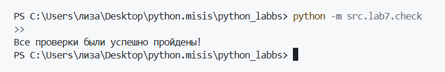
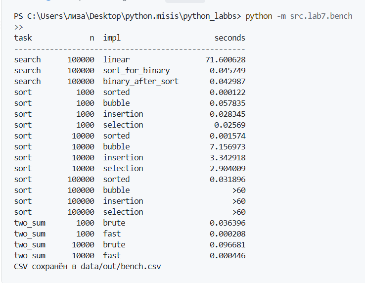

# ЛР7 — `Поиск, сортировка и измерение времени`
### Содержание
**1)** [**Модуль `src/lab7/search.py`**](#модуль-srclab7searchpy--код)
+ [***Разбор кода***](#разбор-кода)
  + [`linear_search(nums, x)`](#linear_searchnums-x)
  + [`binary_search(sorted_nums, x)`](#binary_searchsorted_nums-x)
  + [`two_sum_brute(nums, target)`](#two_sum_brutenums-target)
  + [`two_sum_fast(nums, target)`](#two_sum_fastnums-target)

**2)** [**Модуль `src/lab7/sorting.py`**](#модуль-srclab7sortingpy--код)
+ [***Разбор кода***](#разбор-кода-1)
  + [`bubble_sort(nums)`](#bubble_sortnums)
  + [`insertion_sort(nums)`](#insertion_sortnums)
  + [`selection_sort(nums)`](#selection_sortnums)

**3)** [**Модуль `src/lab07/check.py`**](#модуль-srclab07checkpy--код)
+ [***Разбор кода (check.py)***](#разбор-кода-checkpy)
+ [*`Запуск проверок`*](#запуск-кода)

**4)** [**Модуль `src/lab07/bench.py`**](#модуль-srclab07benchpy)
+ [***Разбор кода (bench.py)***](#разбор-кодаbenchpy)
+ [*`Запуск кода`*](#запуск-benchpy)

**5)** [***Выводы***](#выводы)
## Модуль `src/lab7/search.py` + *код*
```
def linear_search(nums, x):

    for i, n in enumerate(nums):
        if n == x:
            return i

    return -1

def binary_search(sorted_nums, x):

    x1 = 0
    x2 = len(sorted_nums) - 1

    while x1 <= x2:
        mid = (x1+x2)//2

        if sorted_nums[mid] ==x:
            return mid

        elif sorted_nums[mid] < x:
            x1 = mid + 1
        else:
            x2 = mid - 1

    return -1

def two_sum_brute(nums, target):

    for i in range(len(nums)):
        for j in range(i + 1, len(nums)):
            if nums[i] + nums[j] == target:
                return (i, j)

    return None

def two_sum_fast(nums, target):
    d = {}

    for i, x in enumerate(nums):
        pair = target - x

        if pair in d:
            return (d[pair], i)

        d[x] = i

    return None
```
## `Разбор кода`
### `linear_search(nums, x)`
```
def linear_search(nums, x):

    for i, n in enumerate(nums):
        if n == x:
            return i

    return -1
```
> Функция линейно перебирает список `nums` и вовращает `индекс` найденного элемента, если его нет, то вовращает просто `-1`
---
### `binary_search(sorted_nums, x)`
```
def binary_search(sorted_nums, x):

    x1 = 0
    x2 = len(sorted_nums) - 1

    while x1 <= x2:
        mid = (x1+x2)//2

        if sorted_nums[mid] ==x:
            return mid

        elif sorted_nums[mid] < x:
            x1 = mid + 1
        else:
            x2 = mid - 1

    return -1
```
> **`ВАЖНО:`** на вход подается **`ТОЛЬКО ОТСОРТИРОВАННЫЙ СПИСОК`**

> `Почему?` *Функция делит диапазон поиска на два и сравнивает числа рядом.* То есть если список неотсортирован, то элемент никогда не найдется, так как сравнение больше или меньше бесполезно *(функция просто будет срезать и срезать список, пока значений совсем не останется)* 
---
### `two_sum_brute(nums, target)`
```
def two_sum_brute(nums, target):

    for i in range(len(nums)):
        for j in range(i + 1, len(nums)):
            if nums[i] + nums[j] == target:
                return (i, j)

    return None
```
> Функция перебирает пары и находит *первую*, сумма которой равна значению `target` *(если такой пары нет, то выводит просто `None`)*
---
### `two_sum_fast(nums, target)`
```
def two_sum_fast(nums, target):
    d = {}

    for i, x in enumerate(nums):
        pair = target - x

        if pair in d:
            return (d[pair], i)

        d[x] = i

    return None
```
> Для каждого `x` функция ищет значение `target - x`, если оно есть то возвращаются *индексы*, если нет то `x` заносится в словарь со своим индексом *(если пары нет, то `None`)*
---
---
---
## Модуль `src/lab7/sorting.py` + *код*
```
def bubble_sort(nums):

    nums = list(nums)
    n = len(nums)

    for i in range(n):
        fl = 0

        for j in range(n - 1 - i):
            if nums[j] > nums[j+1]:
                nums[j], nums[j+1] = nums[j+1], nums[j]

                fl = 1

        if not fl:
            break

    return nums

def insertion_sort(nums):

    nums = list(nums)

    for i in range(1, len(nums)):

        key = nums[i]
        j = i - 1

        while j >= 0 and nums[j] > key:
            nums[j+1] = nums[j]
            j -= 1

        nums[j+1] = key

    return nums

def selection_sort(nums):

    nums = list(nums)
    n  = len(nums)

    for i in range(n):
        min_idx = i 

        for j in range(i+1, n):
            if nums[j] < nums[min_idx]:
                min_idx = j
        nums[i], nums[min_idx] = nums[min_idx], nums[i]

    return nums
```
## `Разбор кода`
### `bubble_sort(nums)`
```
def bubble_sort(nums):

    nums = list(nums)
    n = len(nums)

    for i in range(n):
        fl = 0

        for j in range(n - 1 - i):
            if nums[j] > nums[j+1]:
                nums[j], nums[j+1] = nums[j+1], nums[j]

                fl = 1

        if not fl:
            break

    return nums
```
> *Функция сортирует копию исходного списка методом пузырька*
---
### `insertion_sort(nums)`
```
def insertion_sort(nums):

    nums = list(nums)

    for i in range(1, len(nums)):

        key = nums[i]
        j = i - 1

        while j >= 0 and nums[j] > key:
            nums[j+1] = nums[j]
            j -= 1

        nums[j+1] = key

    return nums
```
> Функция сортирует копию исходного списка через *сравнение с элементом левее него*, если исходное число меньше числа слева то на место исходного ставится левое число и так по кругу *(исходный элемент сохраняется до `while`, чтобы он не потерялся)*
---
### `selection_sort(nums)`
```
def selection_sort(nums):

    nums = list(nums)
    n  = len(nums)

    for i in range(n):
        min_idx = i 

        for j in range(i+1, n):
            if nums[j] < nums[min_idx]:
                min_idx = j
        nums[i], nums[min_idx] = nums[min_idx], nums[i]

    return nums
```
> Функция сортирует по возрастанию через проход по элементам и *сравнение их с наименьшим числом*, находя число помещает его в начало списка по индексу
---
---
---
## Модуль `src/lab07/check.py` + *код*
```
import random 
from src.lab7.sorting import bubble_sort, insertion_sort, selection_sort
from src.lab7.search import linear_search, binary_search, two_sum_brute, two_sum_fast

def check_sorting(fn, c=100):

    for i in range(c):
        n = random.randint(0, 50)
        nums = [ random.randint(-100, 100) for i in range(n) ]
        oreo = list(nums)

        res = fn(nums)

        assert res == sorted(oreo), f"Функция {fn.__name__} неправильно или вовсе не сортирует список"

        assert oreo == nums, f"Функция {fn.__name__} изменяет исходный список, а не форматирует его копию"


def check_search(c=100):

    for i in range(c):
        n = random.randint(0, 50)
        nums = [random.randint(-100,100) for i in range(n)]

        x = random.randint(-100,100)

        try:
            result = nums.index(x)
        except ValueError:
            result = -1

        res_fn = linear_search(nums, x)
        assert res_fn == result, "Функция linear_search() неправильно нашла искомое значение"

        s_nums = sorted(nums)
        res_fn = binary_search(s_nums, x)

        if x in s_nums:
            assert res_fn != -1 and s_nums[res_fn] == x, "Функция binary_search() неправильно нашла искомое значение"

        else:
            assert res_fn == -1, "Функиция binary_search() нашла то, чего нет"

def check_two_sum(c=100):

    for i in range(c):
        n = random.randint(0, 40)
        nums = [random.randint(-50,50) for i in range(n)]

        target = random.randint(-100,100)
        x1 = two_sum_brute(nums,target)
        x2 = two_sum_fast(nums, target)

        if x1 is None:
            assert x2 is None, f'Функция two_sum_brute() вывела None, а two_sum_fast() вывела {x2}'

        else:
            assert x2 is not None, f"Функция two_sum_fast() не нашла значение"


            assert nums[x2[0]] + nums[x2[1]] == target, "Функция two_sum_fast() вернула неправильное значение"
            assert nums[x1[0]] + nums[x1[1]] == target, "Функция two_sum_brute() вернула неправильное значение"

if __name__ == "__main__":

    random.seed(67)

    for fn in (bubble_sort, insertion_sort, selection_sort):
        check_sorting(fn)

    check_search()
    check_two_sum()
    print("Все проверки были успешно пройдены!")
```
---
---
## `Разбор кода` ***`(check.py)`***
> + ***`n = random.randint(0, 50)`*** - вызывает функцию `randint` из библиотеки `random` для выбора случайного числа в заданном диапазоне
> + `nums.index(x)` - встроенная функция, находящая индекс искомого элемента
> + `random.seed(67)` - фиксирует начальное состояние генератора, чтобы одни и те же данные проверялись на всех функциях *(так легче найти ошибку и ее исправить)*
---
## `Запуск кода`
> *Запуск осуществляется через :*
```
python -m src.lab7.check
```
> *Вывод :*

---
---
---
## Модуль `src/lab07/bench.py`
```
import csv
import random
import signal
import timeit

from src.lab7.sorting import bubble_sort, insertion_sort, selection_sort
from src.lab7.search import linear_search, binary_search, two_sum_brute, two_sum_fast

from src.lab4.io_txt_csv import write_csv

class _timeout(Exception):
    pass

def problem(s, i):
    raise _timeout()

def time_once(fn, timeout=None):

    if timeout is None or not hasattr(signal, "SIGALRM"):
        return timeit.timeit(fn, number=1)

    old = signal.signal(signal.SIGALRM, problem)
    signal.alarm(timeout)

    try:
        return timeit.timeit(fn, number=1)
    except _timeout:
        return None
    finally:
        signal.alarm(0)
        signal.signal(signal.SIGALRM, old)

def bench_sorts():
    rows = []
    sorts = [("sorted",     sorted),
        ("bubble",     bubble_sort),
        ("insertion",  insertion_sort),
        ("selection",  selection_sort)]

    for n in (1_000, 10_000, 100_000):
        data = random.sample(range(0, 1_000_000), n)
        for name, fn in sorts:
            if n >= 100_000 and name in ("bubble", "insertion", "selection"):
                rows.append({"task": "sort", "n": n, "impl": name, "seconds": ">60"})
                continue

            t = time_once(lambda: fn(data), timeout=60)
            seconds = ">60" if t is None else round(t,6)

            rows.append({"task": "sort", "n": n, "impl": name, "seconds": seconds})
    return rows

def bench_search():
    rows = []
    data = random.sample(range(0, 1_000_000), 100_000)
    s = [random.choice(data) for i in range(10_000)]

    t = time_once(lambda: [linear_search(data, i) for i in s])
    rows.append({"task": "search", "n": 100_000, "impl": "linear", "seconds": round(t, 6)})

    t_sort = time_once(lambda: sorted(data))
    rows.append({"task": "search", "n": 100_000, "impl": "sort_for_binary", "seconds": round(t_sort, 6)})

    s_data = sorted(data)
    t = time_once(lambda: [binary_search(s_data, i) for i in s])
    rows.append({"task": "search", "n": 100_000, "impl": "binary_after_sort", "seconds": round(t, 6)})
    
    return rows

def bench_two_sum():
    rows = []
    for n in (1_000, 10_000):
        data = random.sample(range(0, 1_000_000), n)
        target = data[-1] + data[-2]

        t = time_once(lambda: two_sum_brute(data,target))
        rows.append({"task": "two_sum", "n": n, "impl": "brute", "seconds": round(t, 6)})

        t = time_once(lambda: two_sum_fast(data,target))
        rows.append({"task": "two_sum", "n": n, "impl": "fast", "seconds": round(t, 6)})
    
    return rows


def print_table(rows):

    print(f"{'task':<10}{'n':>8}  {'impl':<20}{'seconds':>12}")
    print("-" * len(f"{'task':<10}{'n':>8}  {'impl':<20}{'seconds':>12}"))

    for i in rows:
        print(f"{i['task']:<10}{i['n']:>8}  {i['impl']:<20}{str(i['seconds']):>12}")

if __name__ == "__main__":

    random.seed(67)
    res = []
    res += bench_search()
    res += bench_sorts()
    res += bench_two_sum()

    print_table(res)

    rows_for_csv = [(r["task"], r["n"], r["impl"], r["seconds"]) for r in res]

    write_csv(rows_for_csv, "data/out/bench.csv", ("task", "n", "impl", "seconds"))
    print("CSV сохранён в data/out/bench.csv")
```
### `Разбор кода`*`(bench.py)`*
```
class _timeout(Exception):
    pass
```
> Создание *исключения* для прерывания программы
```
def problem(s, i):
    raise _timeout()
```
> *Функция для обработки сигнала и *вызова* исключения*
---
### **`time_once(fn, timeout=None)`**
> *Она вызывает функции и вовращает время за которое они выполнились*
```
if timeout is None or not hasattr(signal, "SIGALRM"):
        return timeit.timeit(fn, number=1)
```
> Если *максимум* времени не задан или в текущей *Операционной системе* нет сигнала, не ломать программу, а запустить функцию один раз и замерить время ее прохождения
> + `old = signal.signal(signal.SIGALRM, problem)` - указывает, что `problem` является обработчиком сигнала *(сохраняем дефолтную/предыдущую обработку в `old`, чтобы потом ее вернуть, так как он меняется глобально для всего кода)*
> + `signal.alarm(timeout)` - заводит *будильник* *(через `timeout` ОС вызовет сигнал, после чего наш новый класс исключения и выведет `None`)*
```
signal.alarm(0)
signal.signal(signal.SIGALRM, old)
```
> Сбрасываем *таймер/будильник*, чтобы на след проходе не зафиксировался неверный результат. Также вовзвращаем обещанный *предыдущий* обработчик сигнала.
---
### **`bench_sorts()`**
> + `data = random.sample(range(0, 1_000_000), n)` - создание списка *уникальных* элементов с длиной `n`
> + `t = time_once(lambda: fn(data), timeout=60)` - вызов функции для замера времени выполнения функции (передается `lambda:` потому что функция на вход берет саму функцию без аргументов, а не результат)
---
### **`bench_search()`**
> + `s = [random.choice(data) for i in range(10_000)]` - выбирает рандомно элементы из `data` *(10_000 штук, с возможными повторами)*
> + `t = time_once(lambda: [binary_search(s_data, i) for i in s])` - 10_000 запросов на замер времени выполнения функции
---
---
## `Запуск (bench.py)`
`Терминал :`
```
python -m src.lab7.bench
```
> *результат выводится в течении двух минут*

`Результат:` - > *терминал + СSV-файл(bench.csv)*
---
***`Терминал :`***



***`СSV-файл :`***
```
task,n,impl,seconds
search,100000,linear,51.719568
search,100000,sort_for_binary,0.072232
search,100000,binary_after_sort,0.05233
sort,1000,sorted,0.000169
sort,1000,bubble,0.076585
sort,1000,insertion,0.034403
sort,1000,selection,0.033826
sort,10000,sorted,0.002116
sort,10000,bubble,6.415047
sort,10000,insertion,3.028419
sort,10000,selection,2.734695
sort,100000,sorted,0.028435
sort,100000,bubble,>60
sort,100000,insertion,>60
sort,100000,selection,>60
two_sum,1000,brute,0.035408
two_sum,1000,fast,0.000681
two_sum,10000,brute,0.092906
two_sum,10000,fast,0.000429
```
## `Выводы`
**1)** `Почему пузырёк при росте n в 10 раз замедляется в ~100 раз, а sorted — в ~12` - > в пузырьке количество действий это `n^2`, а в sorted это `n * log(n)` (логарифм растет очень медленно, следовательно при увеличении `n`  впервом случае оно будет увеличивать намного быстрее чем логарифм от `n`).

**2)** `Почему бинарный поиск бесполезен без предварительной сортировки, и когда она окупается` - > сортировка окупается когда много запросов, так как она сама занимает также много времени *(если запросов мало то легче использовать линейный поиск)*, бинарный поиск работает по принципу сравнение соседних чисел и после *выкидывает* половину списка, зная что число точно больше/меньше этой части = то есть без сортировки это действия в никуда.

**3)** `Что показал check.py: сколько прогонов, нашёл ли расхождения, как исправили` - > было проведено 300 прогонов (по 100 на каждую сортировку), по 100 прогонов для поиска и two_sum `(всего 500 прогонов)`. В ходе прогонов я обнаружила ошибки в модуле `binary_search()` - забыла добавить условие, что делать если `mid` уже найдено.