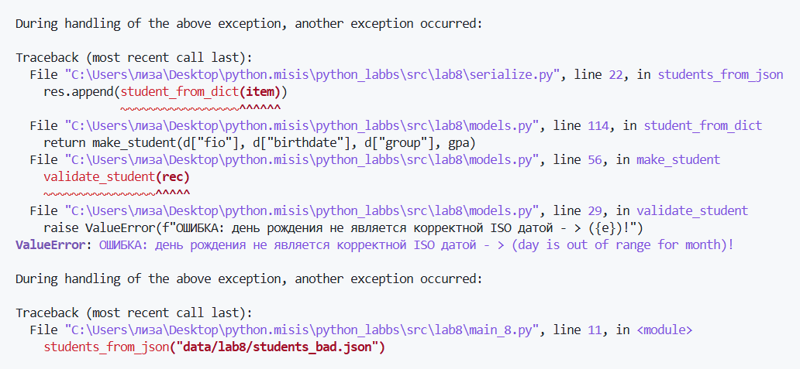

## `ЛР8` – Модель данных без классов: запись Student как словарь, валидация и сериализация


### Содержание
**1)** [`src/lab8/models.py`](#srclab8modelspy)
+ [***Разбор кода***](#разбор-кода)

**2)** [`src/lab8/serialize.py`](#srclab8serializepy)
+ [***Разбор кода***](#разбор-кодаserializepy)

**3)** [**`ЗАПУСК КОДА`**](#запуск-кодmain_8py)
+ [***Запуск `students_input.json`***](#ввод-1)
+ [***Запуск `students_bad.json`***](#ввод-2--битый-json)

**4)** [*Политика обработки битых записей `(Задание B)`*](#политика-обработки-битых-записей-задание-b)

## `src/lab8/models.py`
```
from datetime import date

s_fields = ("fio", "birthdate", "group", "gpa")

def validate_student(rec):

    if not isinstance(rec, dict):
        raise ValueError("ОШИБКА: Данные не являются словарем!")

    if set(rec) != set(s_fields):
        missing = set(s_fields) - set(rec)
        sup = set(rec) - set(s_fields)
        if missing:
            raise ValueError(f"ОШИБКА(потерянные данные): данные '{sorted(missing)}' не попали в rec, хотя были введены!")
        if sup:
            raise ValueError(f"ОШИБКА(лишние данные): данных '{sorted(sup)}' не было в вводе!")

    if not isinstance(rec["fio"], str) or not rec["fio"].strip():
        raise ValueError("ОШИБКА: ФИО пустое или имеет неверный тип данных!")

    if not isinstance(rec["group"], str) or not rec["group"].strip():
        raise ValueError("ОШИБКА: Группа пустая или имеет неверный тип данных!")

    if not isinstance(rec["birthdate"], str):
        raise ValueError("ОШИБКА: День рождения представлено не в виде строки!")
    try:
        b = date.fromisoformat(rec["birthdate"])
    except ValueError as e:
        raise ValueError(f"ОШИБКА: день рождения не является корректной ISO датой - > ({e})!")
    if b > date.today():
        raise ValueError("ОШИБКА: День рождения будет в будущем!")

    if isinstance(rec["gpa"], bool) or not isinstance(rec["gpa"], (int, float)):
        raise ValueError("ОШИБКА: GPA имеет неверный тип данных")
    if not ( 0 <= rec["gpa"] <= 5 ):
        raise ValueError("ОШИБКА: условие '0 <= GPA <= 5' не выполняется")
            

def make_student(fio, birthdate, group, gpa):

    if not isinstance(fio, str):
        raise ValueError("ОШИБКА: ФИО не является строкой!")
    if not fio.strip():
        raise ValueError("ОШИБКА: ФИО не введено!")

    if not isinstance(group, str):
        raise ValueError("ОШИБКА: Группа не является строкой!")
    if not group.strip():
        raise ValueError("ОШИБКА: Группа не введена!")

    if  not isinstance(gpa, (float, int)) or  isinstance(gpa, bool):
        raise ValueError("ОШИБКА: GPA имеет некорректный тип данных!")

    rec = {"fio" : fio.strip(), "birthdate" : birthdate, "group" : group.strip(), "gpa" : float(gpa)}

    validate_student(rec)

    return rec

def student_age(rec, today=None):

    b = date.fromisoformat(rec["birthdate"])
    if today is None:
        today = date.today()

    age = today.year - b.year
    if (today.month, today.day) < (b.month, b.day):
        age -= 1
    return age

def format_student(rec):

    fs = rec["fio"].split()
    if len(fs) >= 2:
        name = fs[0] + " " + "".join(fs[i][0] + "." for i in range(1, len(fs)))
    elif len(fs) == 1:
        name = fs[0]
    else:
        name = rec["fio"]

    age = student_age(rec)
    n = age % 100
    if 5 <= n <= 20:
        y = "лет"
    else:
        n %= 10
        y = "год" if n==1 else "года" if 2 <= n <= 4 else "лет"

    return f"{name} ({rec['group']}), {age} {y}, GPA {rec['gpa']:.2f}"

def student_to_dict(rec):
    validate_student(rec)
    return {i : rec[i] for i in s_fields}


def student_from_dict(d):

    if not isinstance(d, dict):
        raise ValueError("ОШИБКА: Неверный тип данных!")
    
    missing = [i for i in s_fields if i not in d]
    if missing:
        raise ValueError(f"ОШИБКА: не все данные были введены!({missing})")

    gpa = d["gpa"]
    if isinstance(gpa, bool):
        raise ValueError("ОШИБКА: GPA имеет недопустимый тип данных!")
    
    try:
        gpa = float(gpa)
    except (TypeError, ValueError):
        raise ValueError("ОШИБКА: GPA имеет недопустимый тип данных!")
    
    return make_student(d["fio"], d["birthdate"], d["group"], gpa)
```
---
---
## `Разбор кода`
### *`validate_student(rec)`*
```
def validate_student(rec):

    if not isinstance(rec, dict):
        raise ValueError("ОШИБКА: Данные не являются словарем!")

    if set(rec) != set(s_fields):
        missing = set(s_fields) - set(rec)
        sup = set(rec) - set(s_fields)
        if missing:
            raise ValueError(f"ОШИБКА(потерянные данные): данные '{sorted(missing)}' не попали в rec, хотя были введены!")
        if sup:
            raise ValueError(f"ОШИБКА(лишние данные): данных '{sorted(sup)}' не было в вводе!")

    if not isinstance(rec["fio"], str) or not rec["fio"].strip():
        raise ValueError("ОШИБКА: ФИО пустое или имеет неверный тип данных!")

    if not isinstance(rec["group"], str) or not rec["group"].strip():
        raise ValueError("ОШИБКА: Группа пустая или имеет неверный тип данных!")

    if not isinstance(rec["birthdate"], str):
        raise ValueError("ОШИБКА: День рождения представлено не в виде строки!")
    try:
        b = date.fromisoformat(rec["birthdate"])
    except ValueError as e:
        raise ValueError(f"ОШИБКА: день рождения не является корректной ISO датой - > ({e})!")
    if b > date.today():
        raise ValueError("ОШИБКА: День рождения будет в будущем!")

    if isinstance(rec["gpa"], bool) or not isinstance(rec["gpa"], (int, float)):
        raise ValueError("ОШИБКА: GPA имеет неверный тип данных")
    if not ( 0 <= rec["gpa"] <= 5 ):
        raise ValueError("ОШИБКА: условие '0 <= GPA <= 5' не выполняется")
```
> *Функция проверяет словарь `rec`, при появлении ошибки кидает `ValueError` с расшифровкой самой ошибки*
> + `missing` - множество из `s_fields`, отсутствующих в `rec`
> + `sup` - множество из `rec`, отсутствующих в `s_fields`
> + `rec["fio"].strip()` - берем значение из ключа *fio* и убирает пробелы в начале и в конце
> + `b = date.fromisoformat(rec["birthdate"])` - берет *строго* строку *ISO-формата* и преобразовывает в объект `date` *(год, месяц, день)*
---
### *`make_student(fio, birthdate, group, gpa)`*
```
def make_student(fio, birthdate, group, gpa):

    if not isinstance(fio, str):
        raise ValueError("ОШИБКА: ФИО не является строкой!")
    if not fio.strip():
        raise ValueError("ОШИБКА: ФИО не введено!")

    if not isinstance(group, str):
        raise ValueError("ОШИБКА: Группа не является строкой!")
    if not group.strip():
        raise ValueError("ОШИБКА: Группа не введена!")

    if  not isinstance(gpa, (float, int)) or  isinstance(gpa, bool):
        raise ValueError("ОШИБКА: GPA имеет некорректный тип данных!")

    rec = {"fio" : fio.strip(), "birthdate" : birthdate, "group" : group.strip(), "gpa" : float(gpa)}

    validate_student(rec)

    return rec
```
> *Функция проверяет типы данных и их наличие, формирует сам словарь (в конце прогоняет через `validate_student()`)*
---
### *`student_age(rec, today=None)`*
```
def student_age(rec, today=None):

    b = date.fromisoformat(rec["birthdate"])
    if today is None:
        today = date.today()

    age = today.year - b.year
    if (today.month, today.day) < (b.month, b.day):
        age -= 1
    return age
```
> *Функция вычиляет сколько лет студенту, если день рождения еще не наступил, то возвращает `age - 1`*
> + `date.today()` - возвращает текущую дату
> + `today.month` - вовзращает *месяц* из даты `today`
---
### *`format_student(rec)`*
```
def format_student(rec):

    fs = rec["fio"].split()
    if len(fs) >= 2:
        name = fs[0] + " " + "".join(fs[i][0] + "." for i in range(1, len(fs)))
    elif len(fs) == 1:
        name = fs[0]
    else:
        name = rec["fio"]

    age = student_age(rec)
    n = age % 100
    if 5 <= n <= 20:
        y = "лет"
    else:
        n %= 10
        y = "год" if n==1 else "года" if 2 <= n <= 4 else "лет"

    return f"{name} ({rec['group']}), {age} {y}, GPA {rec['gpa']:.2f}"
```
> *Функция возвращает красивую запись данных*
> + *Иванов Иван Иванович - > Иванов И.И.*
> + *( "gpa" : 5 ) - > GPA 5.00*
> + *"2007-05-14" - > 19 лет*
---
### *`student_to_dict(rec)`*
```
def student_to_dict(rec):
    validate_student(rec)
    return {i : rec[i] for i in s_fields}
```
> Функция прогоняет словарь через `validate_student()` и возвращает копию словаря для *сериализации*
---
### *`student_from_dict(d)`*
```
def student_from_dict(d):

    if not isinstance(d, dict):
        raise ValueError("ОШИБКА: Неверный тип данных!")
    
    missing = [i for i in s_fields if i not in d]
    if missing:
        raise ValueError(f"ОШИБКА: не все данные были введены!({missing})")

    gpa = d["gpa"]
    if isinstance(gpa, bool):
        raise ValueError("ОШИБКА: GPA имеет недопустимый тип данных!")
    
    try:
        gpa = float(gpa)
    except (TypeError, ValueError):
        raise ValueError("ОШИБКА: GPA имеет недопустимый тип данных!")
    
    return make_student(d["fio"], d["birthdate"], d["group"], gpa)
```
> *Функция проверяет, что данные это словарь. Проверяет, что все данные на месте + приводит `gpa` к `float`*
---

## `src/lab8/serialize.py`
```
import json

from .models import student_from_dict, student_to_dict

def students_to_json(students, path):
    data = [student_to_dict(s) for s in students]

    with open(path, "w", encoding="utf-8") as f:
        json.dump(data, f, ensure_ascii=False, indent=2)

def students_from_json(path):

    with open(path, "r", encoding="utf-8") as f:
        data = json.load(f)

    if not isinstance(data, list):
        raise ValueError("ОШИБКА: данные не являются списком!")

    res = []
    for i, item in enumerate(data):
        try:
            res.append(student_from_dict(item))
        except ValueError as e:
            raise ValueError(f"ОШИБКА: неправильная запись данных студента(№{i} = {e})")

    return res
```
## `Разбор кода(serialize.py)`
> + `students_to_json(students, path)` - берет список студентов, прогоняет через `student_to_dict` и сохраняет в `JSON-файл`
> + `students_from_json(path)` - берет запись студентов из `JSON` и возвращает валиднуб версию файла
---
---
---
## `Запуск код(main_8.py)`
```
from lab8.serialize import students_from_json, students_to_json

students = students_from_json("data/lab8/students_input.json")
print("прочитано:", len(students))
print(students)

students_to_json(students, "data/lab8/students_output.json")
print("записано в data/lab8/students_output.json")

students_from_json("data/lab8/students_bad.json")
```
```
$env:PYTHONPATH="src"
python src/lab8/main_8.py
```
### **`Ввод №1`**
`students_input.json`
```
[
  {"fio": "Иванов Иван Иванович", "birthdate": "2007-05-14", "group": "БИВТ-26-6-1", "gpa": 4.3},
  {"fio": "Петрова Анна Сергеевна", "birthdate": "2006-11-03", "group": "БИВТ-26-6-2", "gpa": 4.85},
  {"fio": "Сидоров Пётр Алексеевич", "birthdate": "2007-09-20", "group": "БИВТ-26-6-1", "gpa": 3.7},
  {"fio": "Кузнецова Мария Дмитриевна", "birthdate": "2007-02-28", "group": "БИВТ-26-6-2", "gpa": 5}
]
```
### **`Вывод №1`**
`students_output.json`
```
[
  {
    "fio": "Иванов Иван Иванович",
    "birthdate": "2007-05-14",
    "group": "БИВТ-26-6-1",
    "gpa": 4.3
  },
  {
    "fio": "Петрова Анна Сергеевна",
    "birthdate": "2006-11-03",
    "group": "БИВТ-26-6-2",
    "gpa": 4.85
  },
  {
    "fio": "Сидоров Пётр Алексеевич",
    "birthdate": "2007-09-20",
    "group": "БИВТ-26-6-1",
    "gpa": 3.7
  },
  {
    "fio": "Кузнецова Мария Дмитриевна",
    "birthdate": "2007-02-28",
    "group": "БИВТ-26-6-2",
    "gpa": 5.0
  }
]
```
---
---
### **`Ввод №2 = битый JSON`**
`students_bad.json`
```
[
  {"fio": "Иванов Иван Иванович", "birthdate": "2007-05-14", "group": "БИВТ-26-6-1", "gpa": 4.3},
  {"fio": "Плохой Студент", "birthdate": "2003-02-30", "group": "БИВТ-26-6-1", "gpa": 4.0},
  {"fio": "Ещё Один Студент", "birthdate": "2007-06-15", "group": "БИВТ-26-6-1", "gpa": 7},
  {"fio": "Петрова Анна Сергеевна", "birthdate": "2006-11-03", "group": "БИВТ-26-6-2", "gpa": 4.85}
]
```
### **`Вывод №2 = терминал(traceback)`**
```
ValueError: ОШИБКА: день рождения не является корректной ISO датой - > (day is out of range for month)!
```

---
## Политика обработки битых записей `(Задание B)`
> Выбрана стратегия `strict`. То есть при чтении `JSON`, если попадается хотя бы одна невалидная запись, программа не пропускает её, а сразу выбрасывает `ValueError` с указанием номера этой записи и конкретной причины ошибки.